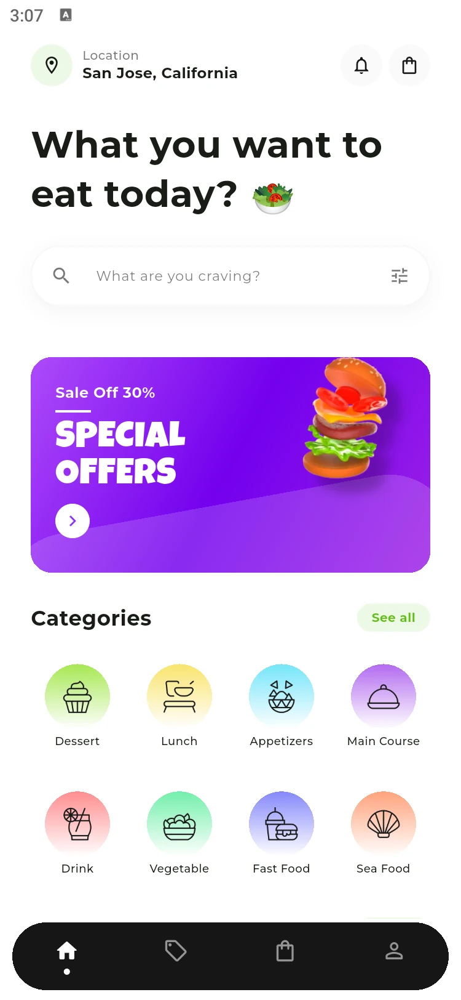
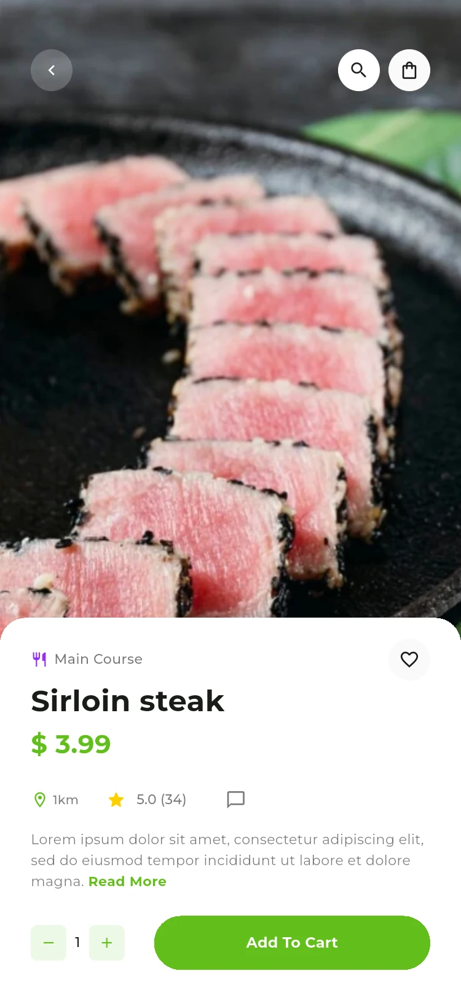
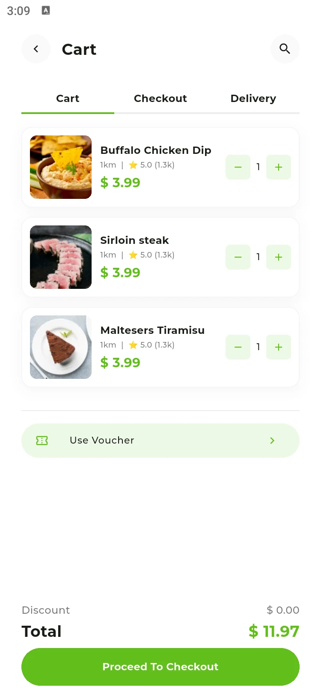
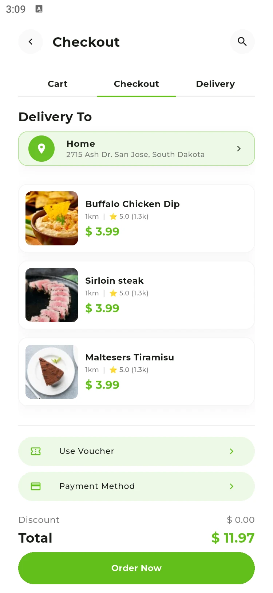
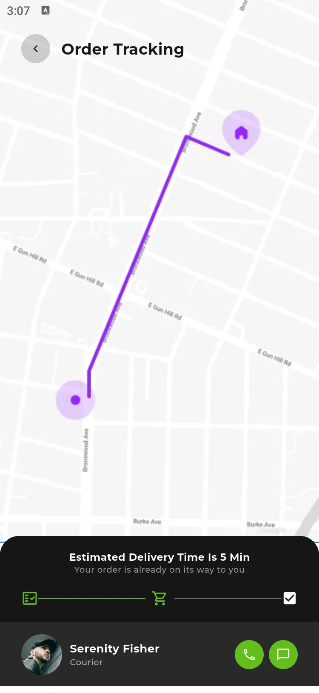
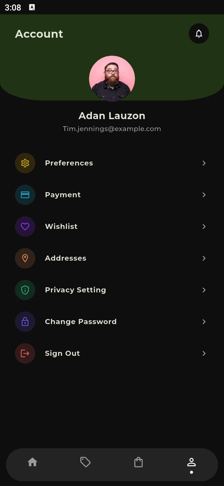

# Mamam Delivery

Mamam Delivery 是一个 Flutter 餐饮外卖演示应用。通过 Pixso MCP 读取「Millio - Food & Beverage」，实现了引导与登录、浏览菜品、搜索、购物车、结算、订单追踪和账户设置。43 个界面共用 Flutter 组件，浅色与深色各有一套外观。

## 主要界面

| 首页 | 菜品详情 | 购物车 |
| --- | --- | --- |
|  |  |  |

| 结算 | 订单追踪 | 深色账户 |
| --- | --- | --- |
|  |  |  |

上述图片来自现有 BlueStacks Android 11 模拟器。全部 86 张截图及对应的 Pixso 节点 ID 见 [界面截图索引](docs/SCREENS.md)。

## 本地体验

环境为 Flutter 3.47.7、Dart 3.13.5 和 Android SDK。可以使用当前已连接的设备。

```powershell
flutter pub get
flutter devices
flutter run -d 127.0.0.1:5555
```

[下载 ARM64 Android 演示安装包](dist/MamamDelivery-arm64.apk)。安装包使用调试签名，供本地体验。x64 模拟器可用上面的源码运行命令。应用启动后可点 **Skip** 跳过引导，输入任意非空用户名与至少 6 个字符的演示密码。注册或重置密码时可输入 `5290` 体验验证。打开 **Account → Preferences → Dark mode** 可切换主题。

商品、优惠券、地址、评论、聊天和通知可在应用内操作。登录、支付、定位、扫码和配送为本地演示。数据保存在当前进程，重启后恢复初始示例。

## 项目结构与验证

```text
lib/app.dart        应用主题、路由、会话注入
lib/core/           数据模型、会话状态、通用 Flutter 组件
lib/features/       账号、商品、结算和通知业务页面
assets/             Pixso 图片素材、字体和许可证
test/               页面渲染和核心流程测试
tool/               截图入口和 ADB 采集脚本
docs/screenshots/   Android 模拟器截图
```

`Session` 以 `ChangeNotifier` 管理本地数据，各功能页共用同一个会话和主题。应用运行时只依赖 Flutter SDK，图片以 WebP 打包。Pixso 分类、模块职责和截图复现步骤见 [项目架构说明](docs/ARCHITECTURE.md)。

```powershell
flutter analyze
flutter test --concurrency=1
```

自动化测试覆盖两种主题下的 43 个界面，以及登录校验、搜索、优惠券、下单和主题切换。截图使用已有的 Android 11 实例采集，采集后恢复了模拟器原有的分辨率、密度和输入法设置。
